  

  
  
  

  

  

  

  

  

<!-- Cards and contributions.json are refreshed daily by .github/workflows/profile-cards.yml. -->
<!-- For a still screenshot, set STATIC=1 and run python render_cards.py before pushing. -->
